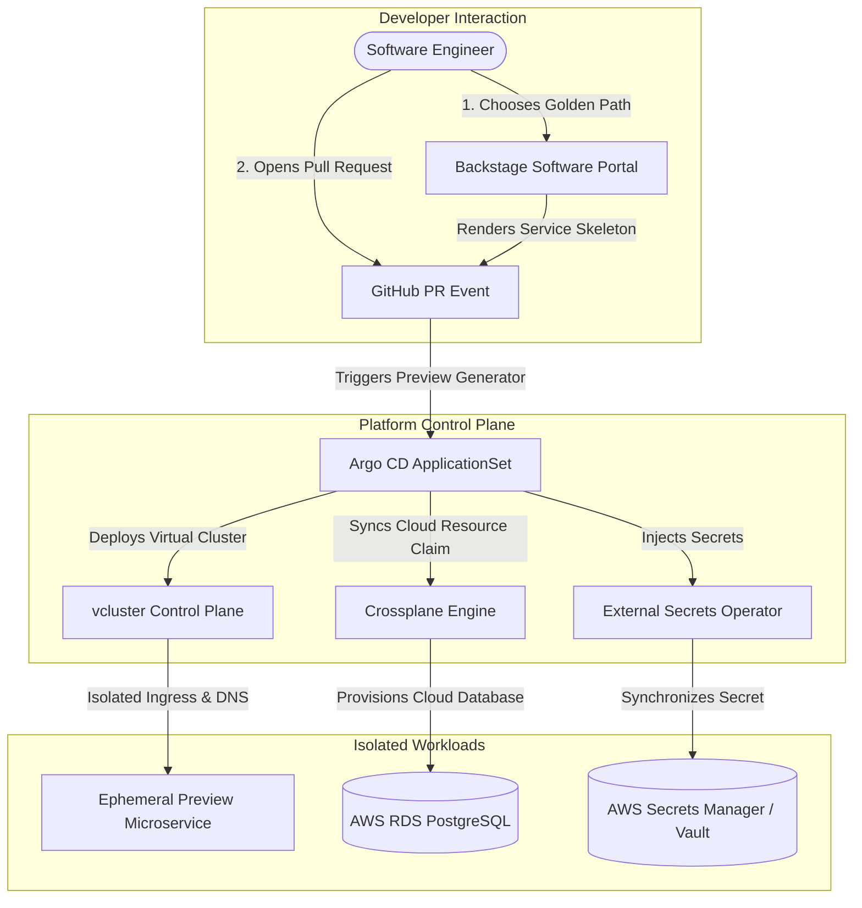

# Enterprise Internal Developer Platform (IDP) with GitOps & Ephemeral Environments

[](https://github.com/Bhomesh/enterprise-idp-gitops-platform/actions/workflows/ci.yml)
[](https://opensource.org/licenses/MIT)
[](https://kubernetes.io)
[](https://argo-cd.readthedocs.io)
[](https://crossplane.io)
[](https://vcluster.com)

A production-grade, end-to-end Enterprise Internal Developer Platform (IDP) enabling software engineering squads to self-serve microservices, cloud infrastructure, and fully isolated ephemeral preview environments via GitOps.

---

## 🌟 Key Capabilities

- **Backstage Golden Path Scaffolder**: Self-service software templates provisioning microservices, cloud resources, and preview clusters with embedded organizational best practices.
- **GitOps Fleet Management with Argo CD**: Root app-of-apps pattern, ApplicationSets for cluster add-ons, and dynamic Pull Request preview generators.
- **Cloud Infrastructure Brokerage with Crossplane**: Declarative Composite Resource Definitions (XRDs) for Amazon RDS PostgreSQL and Amazon S3 with zero cloud console access required.
- **Ephemeral Preview Environments with vcluster**: Lightweight virtual Kubernetes control planes spun up automatically for pull requests, with automated TTL reaping, namespace isolation, and zero noisy-neighbor impact.
- **Dynamic Secret Brokerage with External Secrets Operator (ESO)**: Seamless secret synchronization from AWS Secrets Manager and HashiCorp Vault into workload namespaces.
- **OpenTofu / Terraform Foundation**: Modular, infrastructure-as-code for VPC, EKS, and platform operator bootstrapping.

---

## 🏗️ Architecture Overview



---

## 📂 Repository Structure

```text
├── .github/workflows/ci.yml           # Automated CI linting and test execution
├── Makefile                           # Developer automation commands
├── backstage/
│   ├── catalog-info.yaml             # System and Component entity definitions
│   └── templates/
│       ├── microservice/             # Golden Path template for production microservice
│       │   ├── template.yaml
│       │   └── skeleton/             # App code, Dockerfile, and Helm chart
│       ├── ephemeral-env/            # On-demand vcluster creation template
│       └── cloud-resource/           # Crossplane cloud resource provisioning template
├── crossplane/
│   ├── apis/                         # Composite Resource Definitions (XRDs)
│   │   ├── xrd-postgresql.yaml
│   │   └── xrd-s3-bucket.yaml
│   ├── compositions/                 # Cloud provider mapping compositions
│   │   ├── composition-aws-rds.yaml
│   │   └── composition-aws-s3.yaml
│   └── claims/                       # Developer-facing infrastructure claims
│       ├── database-claim.yaml
│       └── bucket-claim.yaml
├── gitops/
│   ├── bootstrap/                    # Root Argo CD Application & ApplicationSets
│   │   ├── root-application.yaml
│   │   ├── addons-applicationset.yaml
│   │   ├── preview-environments-applicationset.yaml
│   │   └── cluster-fleet-applicationset.yaml
│   └── infrastructure/               # Platform add-on manifests
│       ├── external-secrets/
│       ├── crossplane/
│       └── vcluster/
├── opentofu/                         # Modular OpenTofu / Terraform IaC
│   ├── main.tf
│   ├── variables.tf
│   ├── outputs.tf
│   └── modules/
│       ├── vpc/
│       └── kubernetes/
├── src/                              # Platform lifecycle and validation tooling
│   ├── ephemeral_manager.py          # Ephemeral vcluster manager & TTL reaper
│   ├── template_validator.py         # Backstage catalog schema validator
│   └── crossplane_validator.py       # Crossplane XRD & Composition validator
├── tests/                            # Comprehensive Python unit test suite
└── docs/
    ├── ARCHITECTURE.md               # In-depth architectural specifications
    └── RUNBOOK_EPHEMERAL_ENVIRONMENTS.md # Operations and troubleshooting manual
```

---

## 🚀 Quickstart Guide

### 1. Run Verification Test Suite
Execute the unit and integration tests across all platform components:
```bash
make test
```

### 2. Validate Backstage Templates & Crossplane XRDs
```bash
make validate-templates
make validate-crossplane
```

### 3. Simulate Ephemeral PR Preview Lifecycle
Provision a virtual cluster environment for an active pull request:
```bash
python3 src/ephemeral_manager.py provision
```
Reap stale or expired preview environments exceeding TTL:
```bash
make reap-stale
```

### 4. Deploy Foundation Infrastructure (OpenTofu)
```bash
cd opentofu
tofu init
tofu plan
```

---

## 🔒 Security & Isolation Model

1. **Host-Tenant Isolation**: Each vcluster executes in its own dedicated namespace with strict `ResourceQuota` and `LimitRange` limits.
2. **Network Segmentation**: Explicit `NetworkPolicy` isolates ephemeral preview pods from inter-namespace probing and cloud metadata endpoints (`169.254.169.254`).
3. **Secret Immutability**: No plaintext secrets exist in Git. Credentials are dynamically pulled at runtime via External Secrets Operator using AWS IRSA and Vault Kubernetes Authentication.

---

## 📄 License
This project is licensed under the [MIT License](LICENSE).
