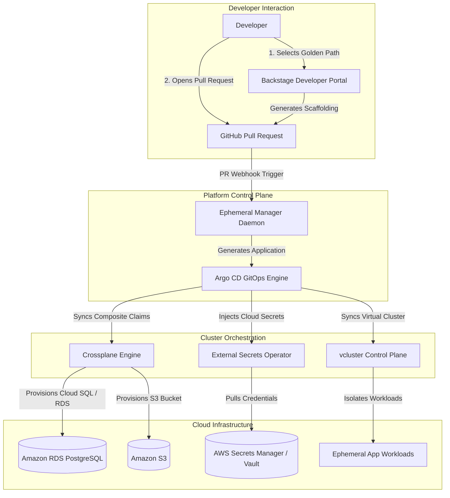

# Enterprise Internal Developer Platform (IDP) Architecture

## Overview

The Enterprise Internal Developer Platform (IDP) establishes an autonomous self-service developer portal and control plane. It decouples product developers from direct infrastructure manipulation while strictly enforcing security, compliance, isolation, and cost guardrails.

## Architectural Pillars

### 1. Developer Portal & Golden Path Scaffolding (Backstage)
- **Catalog Model**: Components, Systems, and Domains registered hierarchically with clear code ownership (`catalog-info.yaml`).
- **Scaffolder Templates**: Reusable parameter schemas that produce ready-to-deploy microservices, spin up isolated preview environments, or provision cloud databases without touching the AWS management console.

### 2. Declarative GitOps Fleet (Argo CD & ApplicationSets)
- **App-of-Apps Root Application**: Anchors cluster state to Git (`gitops/bootstrap/root-application.yaml`).
- **ApplicationSets**:
  - `platform-addons-set`: Automates baseline operators (ESO, Crossplane, vcluster, Ingress-NGINX).
  - `ephemeral-preview-environments`: Integrates the Argo CD Pull Request Generator, dynamically spinning up preview deployments per PR and cleaning them up on merge.
  - `platform-cluster-fleet`: Multi-cluster matrix generator deploying workloads across staging and production clusters.

### 3. Cloud Resource Brokerage (Crossplane)
- **Composite Resource Definitions (XRDs)**: Defines developer abstractions (`XPostgreSQLInstance`, `XBucket`) that expose only 3–5 simple parameters (storage, performance tier, backup frequency).
- **Compositions**: Platform engineers bind XRDs to underlying cloud provider CRDs (e.g., Upbound AWS Provider) enforcing tagging, non-public IP subnets, KMS encryption, and IAM roles.

### 4. Ephemeral Environments with vcluster
- **Virtual Control Planes**: Each Pull Request spins up a dedicated `vcluster` (k3s control plane running inside a host pod).
- **Zero Noisy Neighbors**: Hardened `NetworkPolicy` isolates ephemeral namespaces from each other and prevents access to cloud metadata (169.254.169.254).
- **Resource Quotas & TTL**: Automated 24h expiration (configurable up to 72h max) reaped by the platform manager daemon.

### 5. Dynamic Secret Injection (External Secrets Operator)
- **ClusterSecretStore**: Directs Kubernetes to retrieve database credentials and API tokens dynamically from AWS Secrets Manager and HashiCorp Vault.
- Eliminates hardcoded secrets and unencrypted Git secrets.
